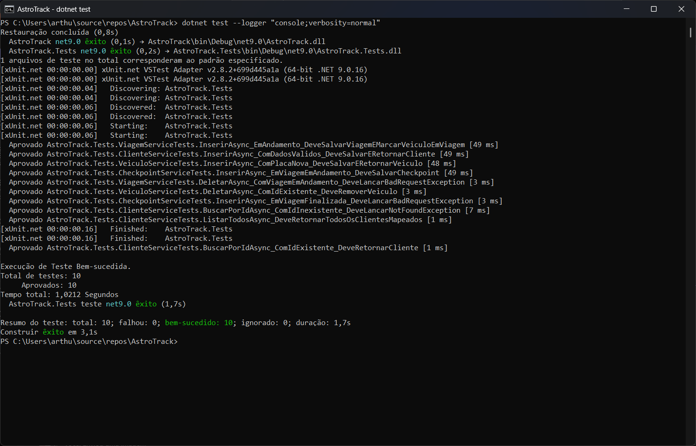
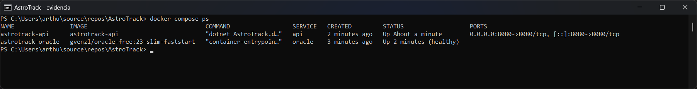
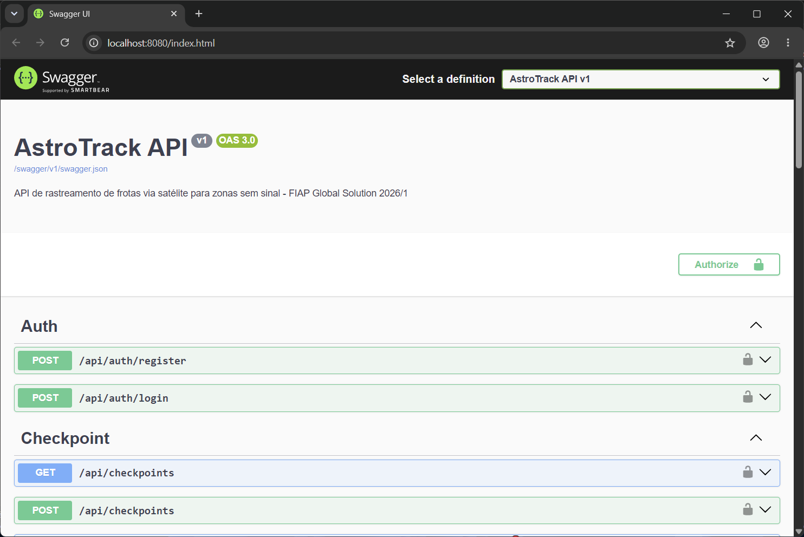
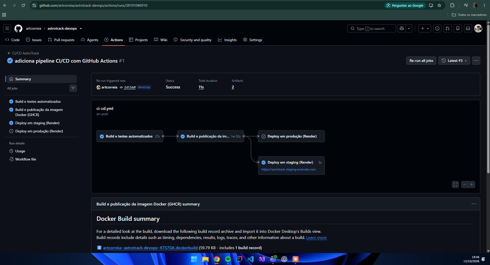
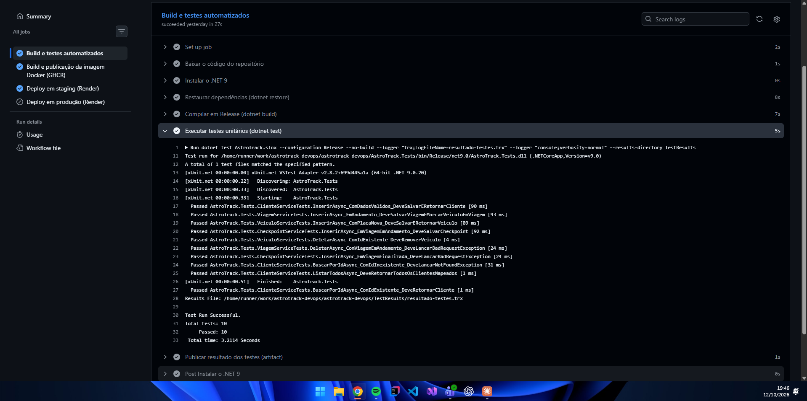
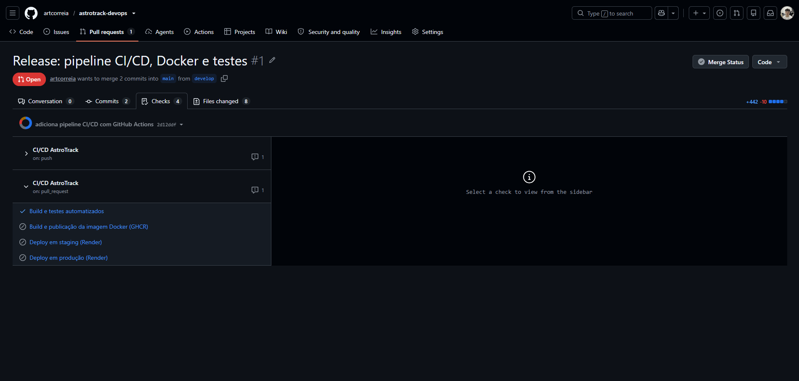
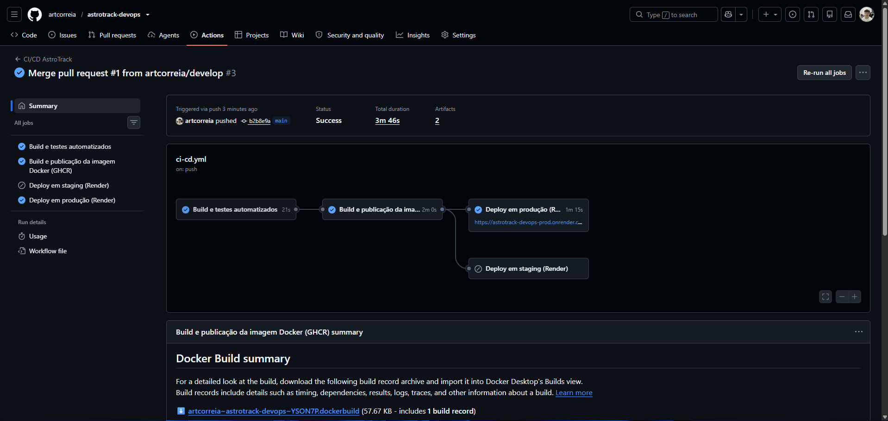
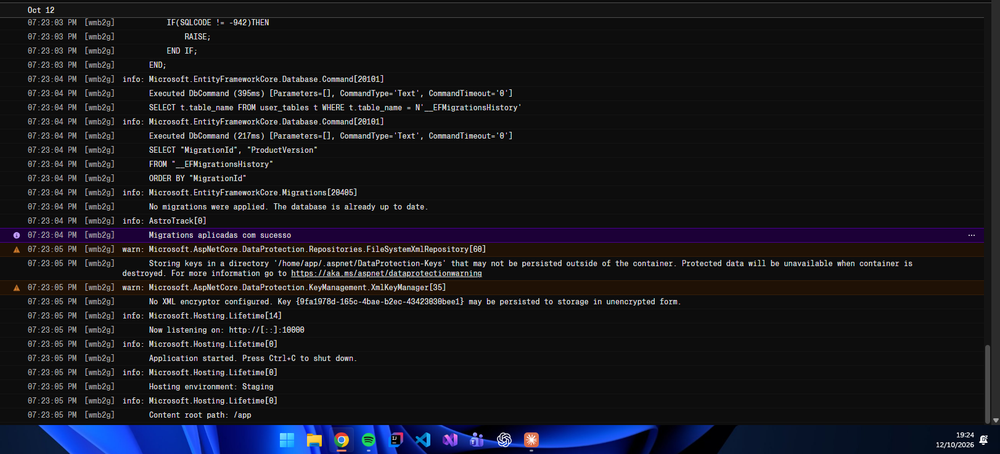
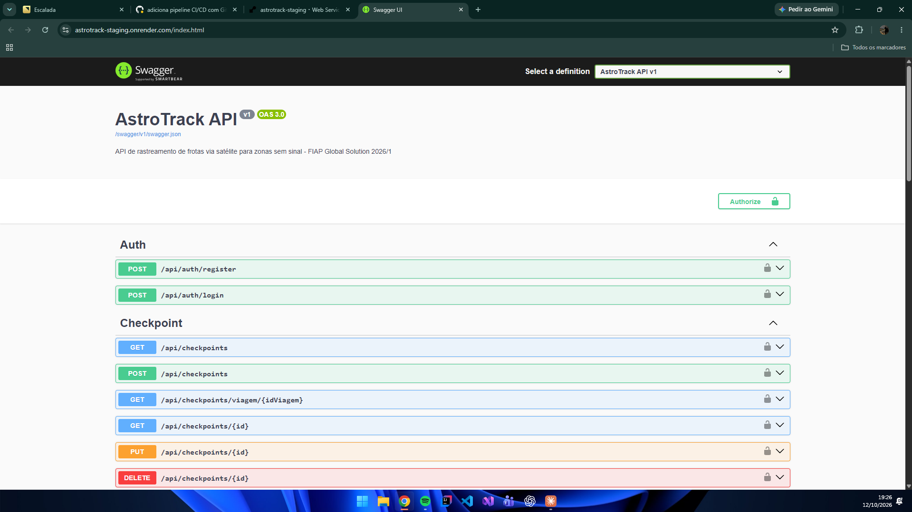
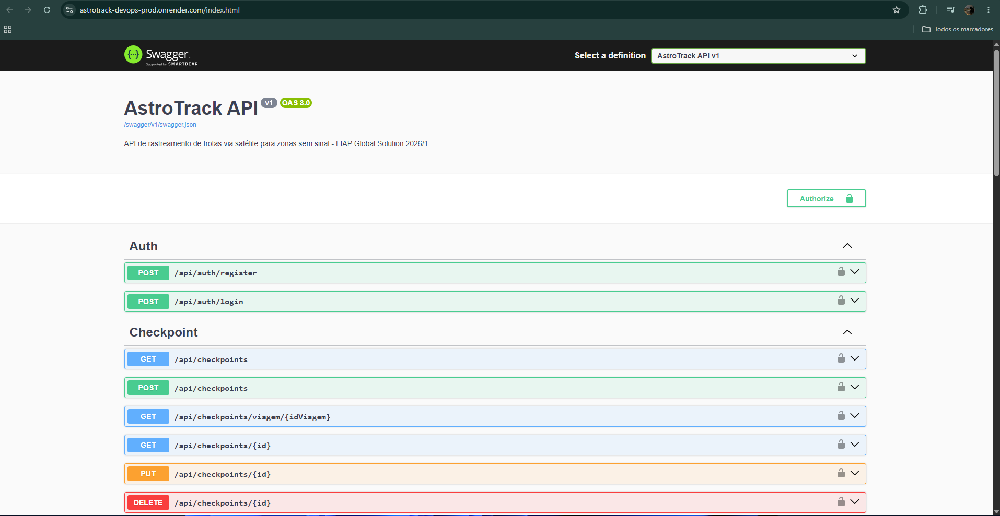

# Projeto - Cidades ESGInteligentes: AstroTrack

API de rastreamento de frotas via satélite para regiões sem cobertura de internet ("zonas de sombra"), ligada à **ODS 9 (Indústria, Inovação e Infraestrutura)**. Nesta entrega, o projeto recebeu práticas completas de DevOps: testes automatizados, containerização, orquestração e pipeline CI/CD com deploy em staging e produção.

### Integrantes

| RM | Nome |
|----|------|
| RM563806 | Arthur Correia Delila |
| RM565677 | Enzo Franchin |
| RM563732 | Gabriel Henrique Souza Gonçalves |
| RM564112 | José Ricardo Pereira Iannuzzi |

### Links

| Ambiente | URL |
|----------|-----|
| Staging | https://astrotrack-staging.onrender.com |
| Produção | https://astrotrack-devops-prod.onrender.com |
| Repositório | https://github.com/artcorreia/astrotrack-devops |

---

## Como executar localmente com Docker

### Pré-requisitos

- [Docker Desktop](https://www.docker.com/products/docker-desktop/) (inclui o Docker Compose)
- [.NET 9 SDK](https://dotnet.microsoft.com/download/dotnet/9.0): necessário **apenas** para rodar os testes

### Passo a passo

1. Clone o repositório:

   ```bash
   git clone https://github.com/artcorreia/astrotrack-devops.git
   cd astrotrack-devops
   ```

2. Copie o arquivo de exemplo de variáveis de ambiente e ajuste as senhas (`ORACLE_PASSWORD`, `APP_USER_PASSWORD`) e a chave `Jwt__Key` (mínimo de 32 caracteres):

   ```bash
   cp .env.example .env        # Linux/macOS/Git Bash
   copy .env.example .env      # Windows (cmd/PowerShell)
   ```

   O `.env` é ignorado pelo git e nunca deve ser commitado.

3. Suba os containers (API + Oracle), construindo a imagem da API:

   ```bash
   docker compose up -d --build
   ```

4. Aguarde o Oracle ficar **healthy**. A API só inicia depois disso e aplica as migrations automaticamente:

   ```bash
   docker compose ps
   ```

5. Acesse a API (Swagger UI) em **http://localhost:8080**.

6. Para parar o ambiente:

   ```bash
   docker compose down
   ```

   Use `docker compose down -v` para remover também o volume `oracle-data`, o que **apaga todos os dados do banco** (na próxima subida o Oracle é recriado do zero e as migrations são aplicadas novamente).

### Como rodar os testes

Na raiz do repositório (não precisa de Docker nem de banco; as dependências são simuladas com Moq):

```bash
dotnet test
```

---

## Pipeline CI/CD

### Ferramentas

- **GitHub Actions:** CI/CD (workflow em [`.github/workflows/ci-cd.yml`](.github/workflows/ci-cd.yml))
- **GitHub Container Registry (GHCR):** registro da imagem Docker (`ghcr.io/artcorreia/astrotrack-devops`)
- **Render:** hospedagem dos ambientes de staging e produção

### Jobs

| Job | Quando roda | O que faz |
|-----|-------------|-----------|
| `build-and-test` | Todo push em `develop`/`main` e todo pull request para `main` | Instala o .NET 9, faz `dotnet restore`, `dotnet build` em Release e `dotnet test`; publica o relatório dos testes (`.trx`) como artifact |
| `docker-image` | Somente em push (não em PR), após `build-and-test` passar | Constrói a imagem a partir do Dockerfile multi-stage (com cache de camadas) e publica no GHCR com duas tags: SHA do commit e nome da branch |
| `deploy-staging` | Push na `develop`, após `docker-image` | Dispara o Deploy Hook do Render no environment `staging` e executa o health check |
| `deploy-production` | Push na `main`, após `docker-image` | Dispara o Deploy Hook do Render no environment `production` e executa o health check |

Cada job só roda se o anterior passar: código que não compila ou com teste falhando nunca vira imagem, e imagem que não foi gerada nunca vai para deploy.

### Fluxo de branches

```text
push na develop               -> build, testes, imagem, deploy em STAGING
pull request develop -> main  -> só build e testes (validação)
merge na main                 -> build, testes, imagem, deploy em PRODUÇÃO
```

### Environments do GitHub

O repositório tem dois environments configurados no GitHub: **`staging`** e **`production`**. Cada um guarda os próprios valores, com o mesmo nome nos dois:

| Nome | Tipo | Uso |
|------|------|-----|
| `RENDER_DEPLOY_HOOK` | Secret | URL do Deploy Hook do serviço no Render, chamada para disparar o deploy |
| `APP_URL` | Variável | URL pública do ambiente, usada no health check e exibida no histórico de deploys |

Os valores não ficam no código; o workflow lê `secrets.RENDER_DEPLOY_HOOK` e `vars.APP_URL` do environment do job.

### Health check

Depois de disparar o deploy, o pipeline consulta `APP_URL/swagger/v1/swagger.json` **a cada 20 segundos por até 10 minutos** (30 tentativas) e só marca o deploy como sucesso se receber **HTTP 200**. Esse documento OpenAPI é gerado pela própria API, então só responde 200 se a aplicação realmente subiu. Se não responder a tempo, o job falha.

---

## Containerização

### Dockerfile

```dockerfile
# ═════════════════════════════════════════════════════════════════════════════
# AstroTrack API - Dockerfile multi-stage
#
# A imagem é construída em dois estágios: um com o SDK completo do .NET, usado
# só para compilar, e outro apenas com o runtime do ASP.NET, que é o que vai
# para produção. O SDK (~800 MB), o código-fonte e os artefatos intermediários
# ficam no primeiro estágio e não chegam à imagem final, que fica menor, sobe
# mais rápido e tem menos superfície de ataque.
# ═════════════════════════════════════════════════════════════════════════════


# ─── Estágio 1: build ────────────────────────────────────────────────────────
# Imagem com o SDK do .NET 9 (compilador, NuGet, MSBuild).
FROM mcr.microsoft.com/dotnet/sdk:9.0 AS build
WORKDIR /src

# Estratégia de cache: copiamos PRIMEIRO só o .csproj e rodamos o restore.
# O Docker cacheia cada camada; como o .csproj muda raramente, a camada com os
# pacotes NuGet baixados é reaproveitada nos builds seguintes. Alterar apenas
# arquivos .cs não invalida esse cache, então o restore não roda de novo.
COPY AstroTrack/AstroTrack.csproj AstroTrack/
RUN dotnet restore AstroTrack/AstroTrack.csproj

# Agora sim copiamos o restante do código e publicamos em Release.
# --no-restore reaproveita os pacotes da camada anterior.
# UseAppHost=false: não gera o executável nativo; a app roda com "dotnet AstroTrack.dll".
COPY AstroTrack/ AstroTrack/
RUN dotnet publish AstroTrack/AstroTrack.csproj \
    --configuration Release \
    --output /app/publish \
    --no-restore \
    /p:UseAppHost=false


# ─── Estágio 2: runtime (imagem final) ───────────────────────────────────────
# Imagem só com o runtime do ASP.NET Core 9, sem SDK nem código-fonte.
FROM mcr.microsoft.com/dotnet/aspnet:9.0 AS final
WORKDIR /app

# Apenas o resultado do publish é copiado do estágio de build.
# Os arquivos ficam com dono root: o usuário da aplicação consegue ler e
# executar, mas não alterar os binários.
COPY --from=build /app/publish .

# Porta HTTP da API. O Program.cs lê a variável PORT e escuta nela.
# ASPNETCORE_HTTP_PORTS (que a imagem base define como 8080) é limpa para
# que PORT seja a única fonte da porta.
ENV PORT=8080 \
    ASPNETCORE_HTTP_PORTS=
EXPOSE 8080

# Segurança: roda como o usuário não-root "app", que já existe na imagem base.
# Se a aplicação for comprometida, o atacante não tem privilégios de root no container.
USER app

ENTRYPOINT ["dotnet", "AstroTrack.dll"]
```

### Estratégias adotadas

- **Multi-stage build:** o estágio `build` usa a imagem do SDK do .NET 9 para compilar e publicar; o estágio final usa apenas o runtime do ASP.NET Core 9. SDK, código-fonte e artefatos intermediários não chegam à imagem final, que fica menor, sobe mais rápido e tem menos superfície de ataque.
- **Cache do restore:** o `.csproj` é copiado primeiro e o `dotnet restore` roda antes de copiar o restante do código. Alterar só arquivos `.cs` não invalida a camada dos pacotes NuGet.
- **Usuário não-root:** a aplicação roda como o usuário `app`, que já existe na imagem base; os binários ficam com dono root e não podem ser alterados por ele.
- **Porta via variável `PORT`:** o `Program.cs` lê `PORT` e escuta nela (padrão `8080`), o que permite rodar tanto localmente quanto no Render sem mudar a imagem.
- **`.dockerignore`:** exclui `bin/`, `obj/`, `.git/`, `.github/`, o projeto de testes, `docs/` e, principalmente, os arquivos `.env`, para que segredos nunca entrem na imagem.

### docker-compose.yml

O [`docker-compose.yml`](docker-compose.yml) orquestra o ambiente completo:

- **Serviços:**
  - `api`: construída a partir do `Dockerfile`, exposta em `${PORT:-8080}:8080`.
  - `oracle`: banco Oracle com a imagem `gvenzl/oracle-free:23-slim-faststart`; o usuário/schema da aplicação é criado no `FREEPDB1` na primeira inicialização.
- **Volume nomeado `oracle-data`:** persiste os dados do banco (`/opt/oracle/oradata`) entre reinicializações dos containers.
- **Rede `astrotrack-net`** (bridge): a API acessa o banco pelo nome do serviço (`oracle:1521/FREEPDB1`).
- **Variáveis via `.env`:** senhas, usuário do banco e configurações JWT vêm do `.env` (modelo em [`.env.example`](.env.example)); as obrigatórias usam `${VAR:?mensagem}`, então o compose falha com uma mensagem clara se faltarem.
- **Healthcheck + `depends_on: service_healthy`:** o Oracle é verificado com o `healthcheck.sh` da própria imagem, e a API só inicia quando o banco está pronto para aceitar conexões.
- **Migrations automáticas:** a API recebe `RUN_MIGRATIONS=true` e aplica as migrations do Entity Framework Core ao subir.

---

## Prints do funcionamento

### Testes


*10 testes xUnit aprovados localmente.*

### Docker local


*Containers `api` e `oracle` rodando (oracle healthy).*


*API respondendo em localhost:8080.*

### Pipeline


*Pipeline da develop com build, testes, imagem e deploy em staging.*


*Testes executados automaticamente no GitHub Actions.*


*PR develop -> main validado (só build e testes).*


*Pipeline da main com deploy em produção.*

### Staging


*Logs do Render com migrations aplicadas e aplicação iniciada.*


*API no ar em staging.*

### Produção


*API no ar em produção.*

---

## Tecnologias utilizadas

- .NET 9
- ASP.NET Core Web API
- Entity Framework Core
- Oracle Database
- JWT
- Swagger
- xUnit
- Moq
- Docker
- Docker Compose
- GitHub Actions
- GitHub Container Registry (GHCR)
- Render

---

## Checklist de entrega

| Item | OK |
|------|----|
| Projeto compactado em .ZIP com estrutura organizada | ✅ |
| Dockerfile funcional | ✅ |
| docker-compose.yml ou arquivos Kubernetes | ✅ |
| Pipeline com etapas de build, teste e deploy | ✅ |
| README.md com instruções e prints | ✅ |
| Documentação técnica com evidências (PDF ou PPT) | ✅ |
| Deploy realizado nos ambientes staging e produção | ✅ |
